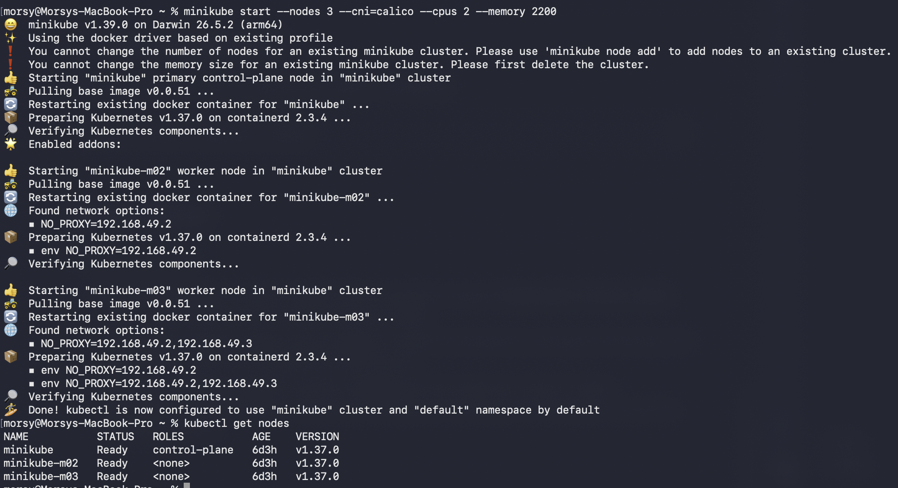
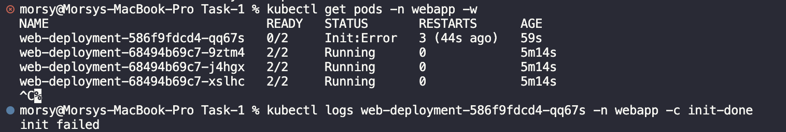
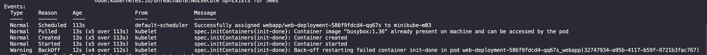
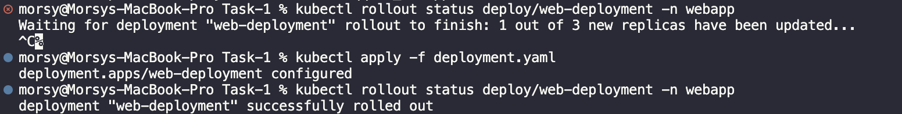

# Task-1: Multi-container Pods (Init Container & Sidecar)
### Started minikube and created 3 nodes

---
### Created deployment.yaml file with the following content
```yaml
apiVersion: apps/v1
kind: Deployment
metadata:
  name: web-deployment
  namespace: webapp
spec:
  replicas: 3
  selector:
    matchLabels:
      app: web
  template:
    metadata:
      labels:
        app: web
    spec:
      shareProcessNamespace: true
      initContainers:
        - name: init-done
          image: busybox:1.36
          command: ["sh", "-c", "echo done"]
      containers:
        - name: nginx
          image: nginx:1.27
          ports:
            - containerPort: 80
          command:
            - /bin/sh
            - -c
            - |
              echo "<h1>hello in MLOPS MENA COMMUNITY : $(date '+%Y-%m-%d %H:%M:%S')</h1>" > /usr/share/nginx/html/index.html
              exec nginx -g 'daemon off;'
        - name: time-updater
          image: busybox:1.36
          securityContext:
            capabilities:
              add:
                - SYS_PTRACE
          command:
            - /bin/sh
            - -c
            - |
              while true; do
                PID=$(pgrep -o nginx)
                if [ -n "$PID" ]; then
                  echo "<h1>hello in MLOPS MENA COMMUNITY : $(date '+%Y-%m-%d %H:%M:%S')</h1>" > /proc/$PID/root/usr/share/nginx/html/index.html
                fi
                sleep 5
              done
```
---
### Applied the deployment.yaml file

---

### Updated the deployment.yaml to cause failure in deployment-fail.yaml, by causing the init container to fail and exit with code 1.




---
### Applied fix (returning to original deployment.yaml) to fix the deployment and make it successful again.

---
# Final Verification Checks
```shell
morsy@Morsys-MacBook-Pro Task-1 % kubectl get nodes
NAME           STATUS   ROLES           AGE    VERSION
minikube       Ready    control-plane   6d3h   v1.37.0
minikube-m02   Ready    <none>          6d3h   v1.37.0
minikube-m03   Ready    <none>          6d3h   v1.37.0
morsy@Morsys-MacBook-Pro Task-1 % kubectl get deploy web-deployment -n webapp
NAME             READY   UP-TO-DATE   AVAILABLE   AGE
web-deployment   3/3     3            3           9m13s
morsy@Morsys-MacBook-Pro Task-1 % kubectl get pods -n webapp -l app=web
NAME                              READY   STATUS    RESTARTS   AGE
web-deployment-68494b69c7-9ztm4   2/2     Running   0          9m19s
web-deployment-68494b69c7-j4hgx   2/2     Running   0          9m19s
web-deployment-68494b69c7-xslhc   2/2     Running   0          9m19s
morsy@Morsys-MacBook-Pro Task-1 % kubectl get pods -n webapp -l app=web -o jsonpath='{.items[0].spec.initContainers[*].name} {.items[0].spec.containers[*].name}'
init-done nginx time-updater%                                                                                                       
morsy@Morsys-MacBook-Pro Task-1 % kubectl logs deploy/web-deployment -n webapp -c init-done
Found 3 pods, using pod/web-deployment-68494b69c7-9ztm4
done
morsy@Morsys-MacBook-Pro Task-1 % kubectl exec deploy/web-deployment -n webapp -c time-updater -- ps
PID   USER     TIME  COMMAND
    1 65535     0:00 /pause
   13 root      0:00 nginx: master process nginx -g daemon off;
   20 101       0:00 nginx: worker process
   21 101       0:00 nginx: worker process
   22 101       0:00 nginx: worker process
   23 101       0:00 nginx: worker process
   24 101       0:00 nginx: worker process
   25 101       0:00 nginx: worker process
   26 101       0:00 nginx: worker process
   27 101       0:00 nginx: worker process
   28 101       0:00 nginx: worker process
   29 101       0:00 nginx: worker process
   30 root      0:00 /bin/sh -c while true; do   PID=$(pgrep -o nginx)   if [ -n "$PID" ]; then     echo "<h1>hello in MLOPS MENA COMMUNITY : $(date '+%Y-%m-%d %H:%M:%S')</h1>" > /proc/$PID/root/usr/share/nginx/html/index.html   fi   sleep 5 done 
  250 root      0:00 ps
morsy@Morsys-MacBook-Pro Task-1 % kubectl exec deploy/web-deployment -n webapp -c nginx -- cat /usr/share/nginx/html/index.html 
<h1>hello in MLOPS MENA COMMUNITY : 2026-11-06 22:13:28</h1>
morsy@Morsys-MacBook-Pro Task-1 % kubectl exec deploy/web-deployment -n webapp -c nginx -- cat /usr/share/nginx/html/index.html 
<h1>hello in MLOPS MENA COMMUNITY : 2026-11-06 22:13:33</h1>
morsy@Morsys-MacBook-Pro Task-1 % kubectl get deploy web-deployment -n webapp -o jsonpath='{.spec.template.spec.volumes}'
morsy@Morsys-MacBook-Pro Task-1 % kubectl get pods -n webapp -l app=web
NAME                              READY   STATUS    RESTARTS   AGE
web-deployment-68494b69c7-9ztm4   2/2     Running   0          10m
web-deployment-68494b69c7-j4hgx   2/2     Running   0          10m
web-deployment-68494b69c7-xslhc   2/2     Running   0          10m
morsy@Morsys-MacBook-Pro Task-1 % kubectl delete namespace webapp
namespace "webapp" deleted
```