# Task-2: Screenshots

## 01 - Images loaded

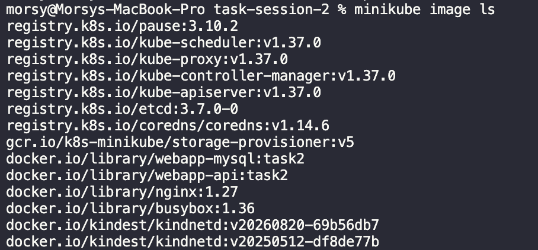

## 02 - Secret and ConfigMap

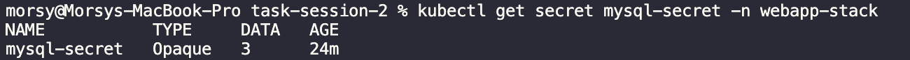

## 03 - PV and PVC bound

## 04 - Deployments ready

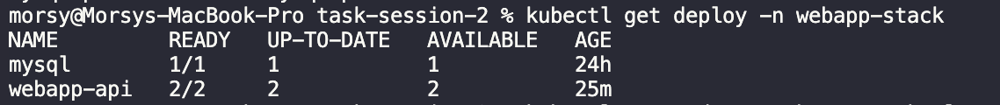
## 05 - MySQL pod on minikube-m02

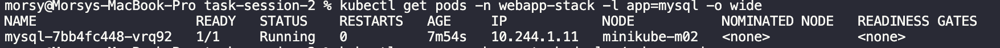
## 06 - App environment

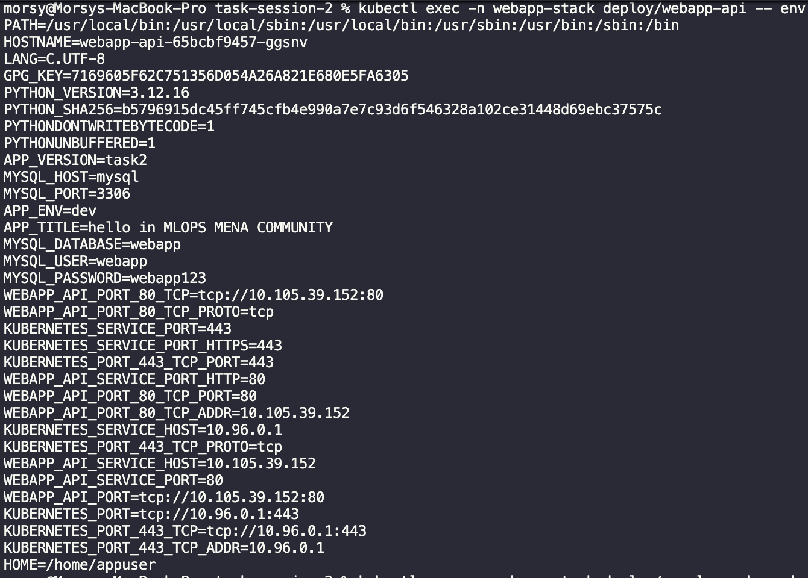
## 07 - Default messages

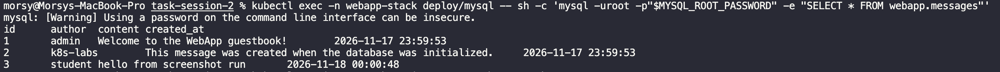
## 08 - Ingress

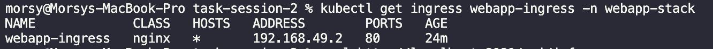
## 09 - App info

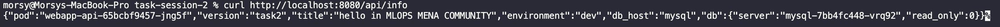
## 10 - Write a message

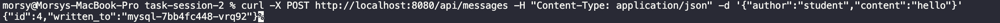
## 11 - Read messages

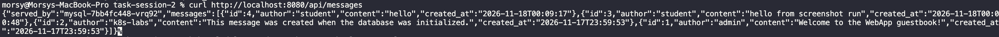
## 12 - MySQL pod restart

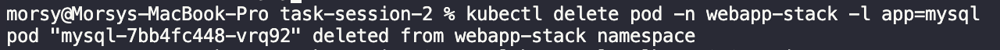
## 13 - Messages after restart

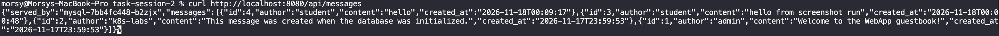